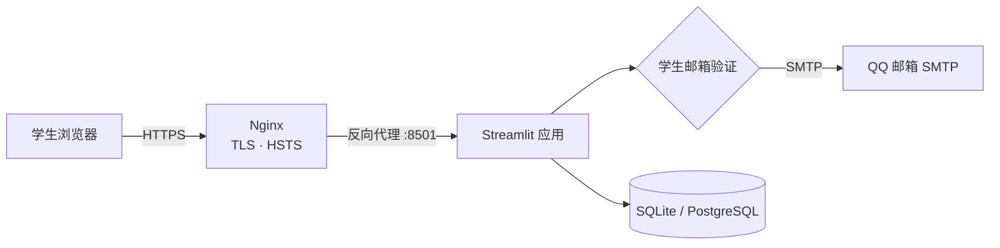

<div align="center">

# 🐟 厦了么鱼

**XMUM Campus Marketplace · 校园二手交易平台**

让闲置流转 · 让校园更有温度

[](https://sdchack.my/)
[](https://www.python.org/)
[](https://streamlit.io/)
[](LICENSE)

[🌐 在线体验](https://cummy.top) · [🚀 部署指南](DEPLOY.md) · [🎬 演示脚本](DEMO.md)

</div>

---

## ✨ 项目简介

「厦了么鱼」是面向 **厦门大学马来西亚分校（XMUM）** 的校园二手交易平台。学生使用 **@xmu.edu.my 学校邮箱** 完成一次性验证码认证后，才能发布闲置商品——用可验证的校园身份，减少匿名账号和校外诈骗。

> SDC Hackathon 2026 · 围绕联合国可持续发展目标（SDG 12：负责任消费与生产）

## 🎯 核心功能

| 功能 | 说明 |
| --- | --- |
| 🎓 学生邮箱认证 | 仅接受 `@xmu.edu.my`；SMTP 真实发信；验证码 10 分钟有效、最多尝试 5 次、60 秒重发冷却 |
| 🛍️ 商品浏览 | 分类筛选、关键词搜索、价格排序、热门推荐 |
| 📦 发布闲置 | 名称 / 分类 / 价格（RM）/ 昵称 / 描述；未认证用户会被拦截 |
| 🎨 品牌化界面 | 嘉庚风格视觉、校园吉祥物、响应式布局 |
| 🗄️ 数据持久化 | 默认 SQLite；设置 `DATABASE_URL` 可切换 PostgreSQL |

## 🖼️ 界面预览


## 🏗️ 技术架构



- **应用层**：Streamlit 多页面 + 自定义 CSS
- **认证**：学校邮箱 + 一次性验证码（SHA-256 加盐哈希、会话内状态）
- **数据层**：SQLite 本地文件，或通过 `DATABASE_URL` 切换 PostgreSQL
- **部署**：Ubuntu + systemd（非 root 运行）+ Nginx 反向代理 + Let's Encrypt

## 🚀 快速开始

```bash
cd 403-forbbiden-qiusiqian
python -m venv .venv
source .venv/bin/activate        # Windows: .venv\Scripts\activate
pip install -r requirements.txt
streamlit run 首页.py
```

打开 http://localhost:8501

### 邮箱验证配置

```ini
EMAIL_VERIFY_MODE=smtp          # dev = 页面显示验证码（仅演示）
SCHOOL_EMAIL_DOMAIN=xmu.edu.my
SMTP_HOST=smtp.qq.com
SMTP_PORT=465
SMTP_USE_SSL=true
SMTP_USER=<your-email>
SMTP_PASSWORD=<smtp-auth-code>
SMTP_FROM=<your-email>
```

> `dev` 模式不会发信，仅用于本地演示；生产请使用 `smtp`。密钥请通过环境变量或 `/etc/xmum-market.env` 注入，**不要提交到仓库**。

## 📁 目录结构

```
403-forbbiden-qiusiqian/
├── 首页.py              主页面（品牌头图 / 搜索 / 商品列表 / 学生认证）
├── pages/               商品分类 / 发布商品 / 关于我们 / 交易规则
├── assets/              校园建筑、吉祥物、分类图
├── brand_assets.py      图片转 data URI、侧边栏装饰
├── database.py          SQLite / PostgreSQL 数据层
├── styles.css           全局样式
└── requirements.txt     Python 依赖
DEPLOY.md                部署与安全指南
DEMO.md                  3 分钟演示脚本
docs/preview.png         首页截图
```

## 🔐 安全与隐私

- 仅接受 `@xmu.edu.my` 学校邮箱；验证码发送到该邮箱，需实际收信才能通过（证明邮箱所有权）
- 验证码加盐哈希存储、10 分钟过期、最多 5 次尝试、60 秒重发冷却
- 部署侧：SSH 仅密钥 + 禁用密码 + root 锁定、fail2ban、ufw、自动安全更新、非 root 系统服务、HTTPS/HSTS
- 仓库不含任何邮箱凭据、SMTP 授权码或 Token；对外仅公开演示域名

## 🧪 测试

- E2E（Streamlit AppTest）：邮箱验证 → 发布商品 → SQLite 落库 → 未认证用户拦截
- 已在线上环境完成 SMTP 投递验证

## ⚠️ 当前限制

- 验证状态保存在浏览器会话；刷新或重启后需重新验证（下一步：持久化账户）
- `dev` 模式不验证邮箱所有权，仅用于演示
- 暂无管理后台 / 举报 / 风控

## 🗺️ Roadmap

- [ ] 持久化学生账户与登录态
- [ ] 举报 / 审核 / 风控
- [ ] 商品图片上传
- [ ] 校内交收点与消息通知

## 📄 License

MIT（见 [LICENSE](LICENSE)）
