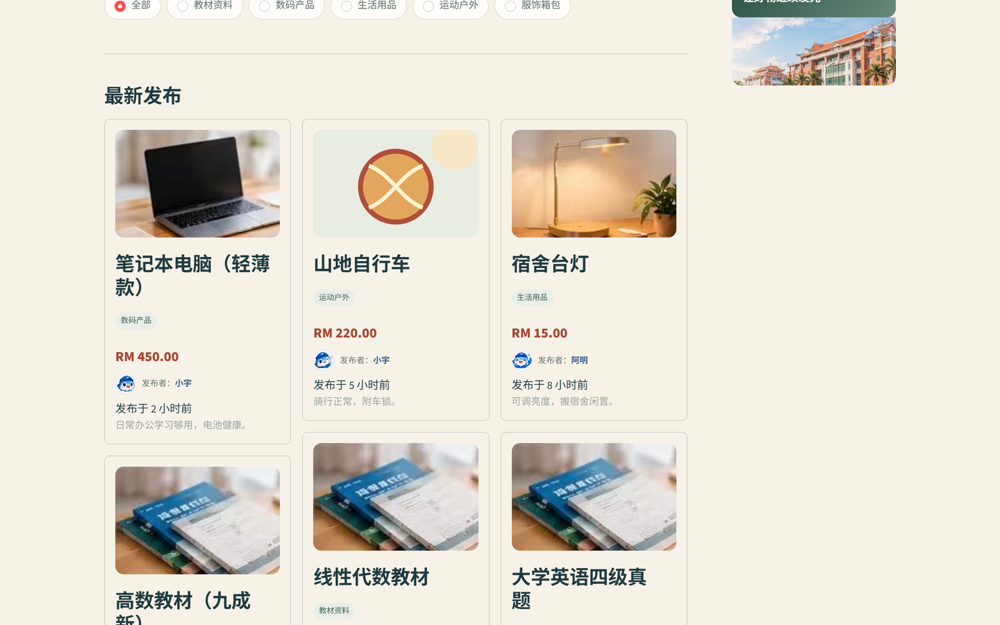
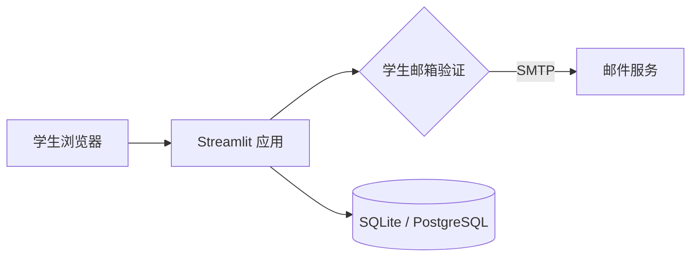

<div align="center">

# 🐟 厦了么鱼

**XMUM Campus Marketplace · 校园二手交易平台**

让闲置流转 · 让校园更有温度

[](https://sdchack.my/)
[](https://www.python.org/)
[](https://streamlit.io/)
[](LICENSE)

[🎬 演示脚本](DEMO.md)

</div>

---

## ✨ 项目简介

「厦了么鱼」是面向 **厦门大学马来西亚分校（XMUM）** 的校园二手交易平台。学生使用 **@xmu.edu.my 学校邮箱** 完成一次性验证码认证后，才能发布闲置商品——用可验证的校园身份，减少匿名账号和校外诈骗。

> SDC Hackathon 2026 · 围绕联合国可持续发展目标（SDG 12：负责任消费与生产）

## 🎯 核心功能

| 功能 | 说明 |
| --- | --- |
| 🎓 学生邮箱认证 | 仅接受 `@xmu.edu.my`；验证码 10 分钟有效、最多尝试 5 次、60 秒重发冷却 |
| 🛍️ 商品浏览 | 分类筛选、多词/同义词搜索、相关性排序、价格排序、最新发布 |
| 📦 发布闲置 | 名称 / 分类 / 价格（RM）/ 昵称 / 描述 / 可选联系方式；未认证用户会被拦截 |
| 🤝 联系方式与售出 | 支持 WhatsApp / Telegram 链接或微信号；发布者可标记已售出，已售商品默认隐藏 |
| 🎨 品牌化界面 | 嘉庚风格视觉、校园吉祥物、响应式布局 |
| 🗄️ 数据持久化 | 默认 SQLite；设置 `DATABASE_URL` 可切换 PostgreSQL |

## 🖼️ 界面预览



## 🏗️ 技术架构



- **应用层**：Streamlit 多页面 + 自定义 CSS
- **认证**：学校邮箱 + 一次性验证码（SHA-256 加盐哈希、会话内状态）
- **数据层**：SQLite 本地文件，或通过 `DATABASE_URL` 切换 PostgreSQL

## 🚀 快速开始

```bash
cd 403-forbbiden-qiusiqian
python -m venv .venv
source .venv/bin/activate        # Windows: .venv\Scripts\activate
pip install -r requirements.txt
streamlit run 首页.py
```

打开 http://localhost:8501

### 邮箱验证配置

```ini
EMAIL_VERIFY_MODE=smtp          # dev = 页面显示验证码（仅演示）
SCHOOL_EMAIL_DOMAIN=xmu.edu.my
SMTP_HOST=<smtp-host>
SMTP_PORT=465
SMTP_USE_SSL=true
SMTP_USER=<your-email>
SMTP_PASSWORD=<smtp-auth-code>
SMTP_FROM=<your-email>
```

> `dev` 模式不会发信，仅用于本地演示；生产请使用 `smtp`。密钥请通过环境变量注入，**不要提交到仓库**。

## 📁 目录结构

```
403-forbbiden-qiusiqian/
├── 首页.py              主页面（品牌头图 / 搜索 / 商品列表 / 学生认证）
├── pages/               商品分类 / 发布商品 / 关于我们 / 交易规则
├── assets/              校园建筑、吉祥物、分类图
├── tests/               AppTest 流程测试（使用临时 SQLite）
├── brand_assets.py      图片转 data URI（带缓存）、侧边栏装饰
├── database.py          SQLite / PostgreSQL 数据层
├── product_ui.py        联系方式与售出操作
├── search_utils.py      多词/同义词搜索与建议
├── text_utils.py        邮箱打码、相对时间等文本工具
├── styles.css           全局样式
├── requirements.txt     Python 依赖
└── requirements-dev.txt 测试依赖
DEMO.md                  3 分钟演示脚本
docs/preview.png         首页截图
```

## 🔐 安全与隐私

- 仅接受 `@xmu.edu.my` 学校邮箱；验证码发送到该邮箱，需实际收信才能通过（证明邮箱所有权）
- 验证码加盐哈希存储、10 分钟过期、最多 5 次尝试、60 秒重发冷却
- 服务端按邮箱哈希记录验证失败，15 分钟内错误 ≥10 次会锁定 15 分钟；验证成功后清空失败记录
- 页面上的认证邮箱统一打码展示（如 `alice@xmu.edu.my` → `a***@xmu.edu.my`）；完整邮箱仍保留在会话状态与 `seller_email` 字段中，仅用于商品所有权判断，不会展示
- 商品联系方式由用户填写：链接仅支持 http(s)/mailto，纯文本按原文转义展示；发布时拒绝 `javascript:`、`data:` 等危险前缀
- `seller_email` 不会随商品列表返回或展示
- 仓库不含任何邮箱凭据、SMTP 授权码或 Token

## 🧪 测试

在应用目录安装依赖并运行：

```bash
cd 403-forbbiden-qiusiqian
pip install -r requirements.txt -r requirements-dev.txt
pytest -q
```

测试使用 `tests/test_flow.py` 中的临时 SQLite 数据库，不会读写 `campus_market.db`。覆盖多词/同义词搜索与建议、价格排序、分类白名单、服务端校验、重复提交、验证码错误/过期与失败锁定、未认证发布拦截、发布落库、联系方式校验、已售出过滤与列表上限。

## 🤝 联系方式与已售出

- 发布商品时可填写「联系方式（选填，公开展示）」：WhatsApp / Telegram 链接会显示为「联系卖家」按钮，微信号等纯文本会以 `联系方式：...` 展示
- 只有发布者本人会看到「标记已售出」；标记后商品从公开列表隐藏，但仍计入「关于我们」的总数统计
- 已售商品不会出现在首页和商品分类页的在售列表中

可复制 `.env.example` 为本地 `.env` 后填写配置；示例文件不包含任何真实凭据。

## ⚠️ 当前限制

- 验证状态保存在浏览器会话；刷新或重启后需重新验证（下一步：持久化账户）
- `dev` 模式不验证邮箱所有权，仅用于演示
- 暂无管理后台 / 举报 / 风控

## 🗺️ Roadmap

- [ ] 持久化学生账户与登录态
- [ ] 举报 / 审核 / 风控
- [ ] 商品图片上传
- [ ] 校内交收点与消息通知

## 📄 License

Apache License 2.0（见 [LICENSE](LICENSE) 与 [NOTICE](NOTICE)）
